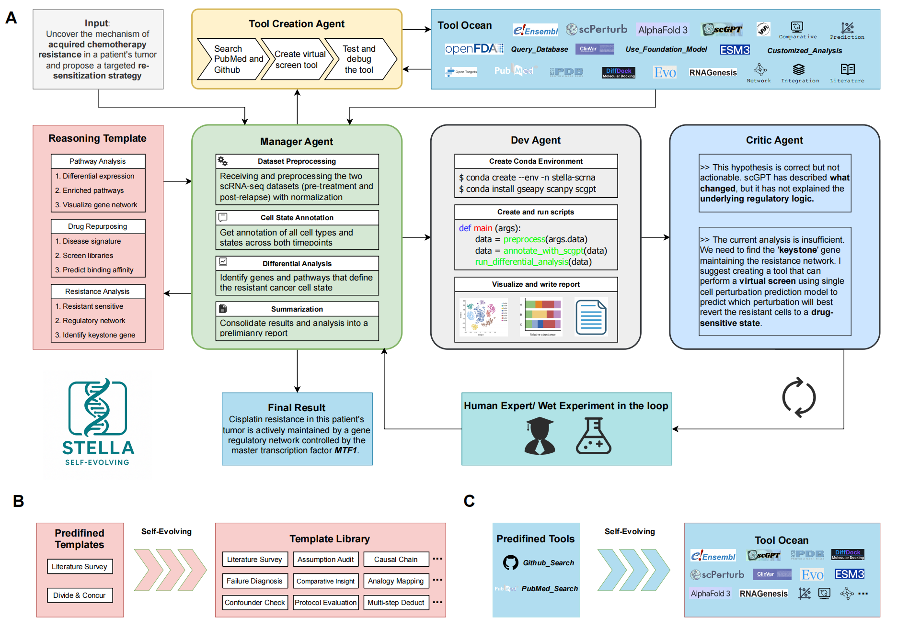
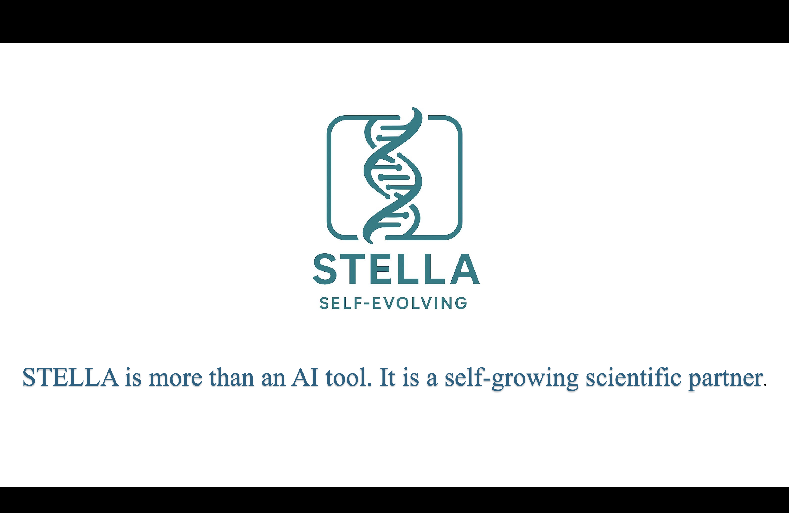
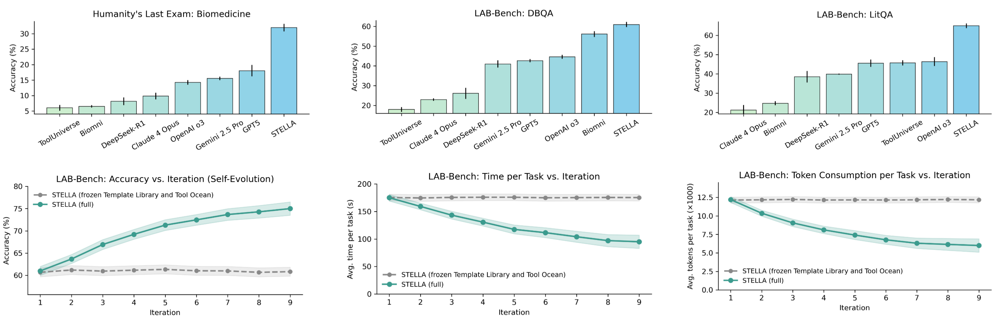

<div align="center">


# STELLA

### Self-Evolving Multimodal Agents for Biomedical Research

[](https://github.com/zaixizhang/STELLA)
[](LICENSE)
[](https://www.biorxiv.org/content/10.1101/2025.07.01.662467v2)
[](https://arxiv.org/abs/2507.02004)
[](https://stella-agent.app/)

[**Paper**](https://www.biorxiv.org/content/10.1101/2025.07.01.662467v2) | [**Online Demo**](https://stella-agent.app/) | [**arXiv**](https://arxiv.org/abs/2507.02004) | [**Twitter**](https://x.com/BiologyAIDaily/status/1941122955850993966)

### :rocket: [Try STELLA Online — No Installation, No API Keys, One Click to Start!](https://stella-agent.app/)
**[:globe_with_meridians: stella-agent.app](https://stella-agent.app/)**

**Authors:**
Ruofan Jin<sup>1</sup>, Mingyang Xu<sup>2</sup>, Fei Meng<sup>3,4</sup>, Guancheng Wan<sup>5</sup>, Qingran Cai<sup>6</sup>, Yize Jiang<sup>7</sup>, Jin Han<sup>8</sup>, Yuanyuan Chen<sup>9</sup>, Wanqing Lu<sup>9</sup>, Mengyang Wang<sup>10</sup>, Zhiqian Lan<sup>11</sup>, Yuxuan Jiang<sup>11</sup>, Junhong Liu<sup>7,✉</sup>, Dongyao Wang<sup>3,4,✉</sup>, Le Cong<sup>12,✉</sup>, and Zaixi Zhang<sup>1,✉</sup>

<sup>1</sup>Princeton University, <sup>2</sup>University of Michigan, <sup>3</sup>The First Affiliated Hospital, USTC, <sup>4</sup>National Key Laboratory of Immune Response and Immunotherapy
<sup>5</sup>UCLA, <sup>6</sup>Shanghai Jiao Tong University, <sup>7</sup>Microcyto, <sup>8</sup>Nanjing University, <sup>9</sup>Tianjin University of Science and Technology
<sup>10</sup>Peking University, <sup>11</sup>The University of Hong Kong, <sup>12</sup>Stanford University
<sup>✉</sup> liujunhong@microcyto.cn, dywsn@ustc.edu.cn, congle@stanford.edu, zz8680@princeton.edu

</div>

---

## Contents

- [Overview](#overview)
- [Demo Video](#demo-video)
- [Key Results](#key-results)
- [Quick Start](#quick-start)
- [Repository Layout](#repository-layout)
- [Installation](#installation)
- [Resource Download](#resource-download--setup)
- [API Keys](#api-keys)
- [Tool Creation Benchmark](#tool-creation-benchmark)
- [Case Studies & Reproducibility](#case-studies--reproducibility)
- [Parameter-Level Self-Evolution](#parameter-level-self-evolution)
- [Citation](#citation)
- [Related Projects](#related-projects)
- [License](#license)

## Overview



*Overview of the STELLA framework. The framework consists of four main components: a manager agent, a dev agent, a critic agent, and a tool ocean. The template system provides structured workflows learned from successful runs.*

| Component | Description |
|-----------|-------------|
| **Manager Agent** | Decomposes scientific objectives, retrieves relevant templates, orchestrates sub-agents |
| **Dev Agent** | Executes bioinformatics analyses, runs code, queries databases and literature |
| **Critic Agent** | Evaluates result quality, identifies gaps, recommends improvements |
| **Tool Creation Agent** | Dynamically creates new tools when existing ones are insufficient |
| **Tool Ocean** | 60+ predefined and self-evolving tools for literature search, databases, virtual screening |
| **Template System** | Retrieves, applies, and auto-creates structured workflow skills from successful runs |

All four agents use **Claude 4 Sonnet** (`anthropic/claude-sonnet-4`) by default, as reported in the paper. Models are configurable via [OpenRouter](https://openrouter.ai/) — edit the model variables in `stella/core.py` to switch between Claude, GPT, Gemini, and other providers.


**Try STELLA online at [stella-agent.app](https://stella-agent.app/) — no installation required.**


## Demo Video

[](https://drive.google.com/file/d/1a6PoJWZMMix8zyccWVOZxU47NKhABO_W/view?usp=sharing)

*Click the thumbnail above to watch the STELLA demonstration video on Google Drive.*

## Key Results



Key achievements:
- Best performance on built tool creation benchmark and public benchmark (LabBench, HLE)
- Identified **BTN3A1** as a novel regulator in acute myeloid leukemia, verified through CRISPR studies across 4 cell lines
- Developed enzyme variants showing **>2x improvement** in catalytic activity
- Robotic laboratory automation with success rates improving from **17% to 82%**


## Quick Start

**Option 1: Use the online version (recommended)**

Visit [stella-agent.app](https://stella-agent.app/) to use STELLA directly in your browser.

**Option 2: Docker image**

A pre-built Docker image package (including ablation variants) is available on [Google Drive](https://drive.google.com/file/d/1iN9AOJpi0FBDz7i_gjmW8EbcjTY0z8bF/view). See [`docker/README.md`](docker/README.md) for download and usage instructions.

**Option 3: Run locally (from source)**

```bash
# Clone and install
git clone https://github.com/zaixizhang/STELLA.git
cd STELLA
pip install -e .

# Configure API key
echo "OPENROUTER_API_KEY=your_key_here" > .env

# Launch web UI
python -m stella
```

Open http://localhost:7860 in your browser. A public Gradio link is also generated automatically.

### Usage Options

| Mode | Command | Description |
|------|---------|-------------|
| **Web UI** | `python -m stella` | Full Gradio interface with skill retrieval (recommended) |
| **No Skills** | `python -m stella --no_template` | Disable skill/template retrieval |
| **Tool Creation** | `python -m stella --enable_tool_creation` | Enable dynamic tool creation agent |
| **Custom Port** | `python -m stella --port 8080` | Run on a different port |
| **Web Launcher** | `python -m stella.ui.launcher` | Alternative launcher with preset config |

### Programmatic Usage

```python
from stella.core import initialize_stella

manager_agent = initialize_stella(
    use_template=True,
    enable_tool_creation=True,
)
result = manager_agent.run("What genes are associated with breast cancer resistance?")
```

## Repository Layout

```text
STELLA/
├── stella/                    # Installable application package
│   ├── core.py                # Agent orchestration
│   ├── ui/                    # Gradio interface and launcher
│   ├── skills/                # Workflow storage, retrieval and learning
│   ├── tools/                 # Predefined tools, biomedical tools and governance
│   ├── self_evolve/           # Trajectories, verification, training and serving
│   └── resources/             # Bundled logo, prompts, skill templates and tool manifests
├── benchmarks/tool_creation/  # Simple/hard benchmark runners and results
├── examples/cases/            # Paper case-study scripts
├── tests/                     # Offline regression tests
├── docs/                      # Guides and README images
├── docker/                    # Docker image instructions
├── requirements/              # Optional training dependencies
└── data/                      # Writable skills, generated tools and run database
```

Standard project files (`README.md`, `LICENSE`, `pyproject.toml`, `requirements.txt`,
`MANIFEST.in`, and `Dockerfile`) remain at the root.

Use `python -m stella` (or the installed `stella` command) to launch the app.
Python imports now use the `stella` namespace, for example
`from stella.core import initialize_stella`. See the
[migration and development guide](docs/development.md) for old-to-new paths,
runtime data locations, and validation commands.

## Installation

### Option 1: Using Conda (Recommended)
```bash
# Clone the repository
git clone https://github.com/zaixizhang/STELLA.git
cd STELLA

# Create conda environment
conda create -n stella python=3.12 -y
conda activate stella

# Install scientific packages via conda
conda install -c conda-forge numpy pandas scikit-learn matplotlib seaborn -y

# Install remaining dependencies via pip
pip install -e .
```

### Option 2: Using pip only
```bash
pip install -e .
```

### Option 3: Using Docker

A pre-built Docker image package is available. See [`docker/README.md`](docker/README.md) for download and usage instructions.

### Optional Dependencies
```bash
# For biomedical analysis
pip install biopython rdkit-pypi

# For MCP tools integration
pip install mcp uv
```

## Resource Download & Setup

**Large Resource Files**: Due to the size of biomedical datasets, additional resources are available for download:

```bash
# Download the resource package (optional for basic usage)
# Manual download from: https://drive.google.com/file/d/1n8I-gkM58wL1OZysdpYhr-Q9ZApd9yU4/view?usp=sharing
# File: resource_backup_20250719_055729.zip (2.0GB compressed)

# Create resource directory and extract
mkdir -p resource/
unzip resource_backup_20250719_055729.zip -d resource/
```

> **Note**: Resources are optional for basic STELLA functionality but enhance performance for complex biomedical tasks.

## API Keys

> **Don't have API keys?** No worries — you can directly try our online version at **[stella-agent.app](https://stella-agent.app/)**. No installation, no API keys needed — just one click and start using STELLA right away!

For local deployment, configure the following API keys:

| Key | Required | Purpose |
|-----|:--------:|---------|
| `OPENROUTER_API_KEY` | **Yes** | Powers all LLM agents via OpenRouter |
| `SERPAPI_API_KEY` | No | Enhanced web search results |
| `PAPERQA_API_KEY` | No | Academic literature analysis |

```bash
# Create .env file with your API keys
echo "OPENROUTER_API_KEY=your_openrouter_api_key_here" > .env
echo "SERPAPI_API_KEY=your_serpapi_key_here" >> .env
```

**Get API Keys:**
- OpenRouter: https://openrouter.ai/
- SERPAPI: https://serpapi.com/

## Tool Creation Benchmark

The **Tool Creation Benchmark** evaluates biomedical AI agents across 117 tasks organized into two difficulty tiers. All benchmark files are in the [`benchmarks/tool_creation/`](benchmarks/tool_creation/) directory.

| Set | Categories | Tasks | Evaluation |
|-----|-----------|-------|------------|
| **Simple Set** | Protocol/Design/Computation/Database/Web Retrieval | 99 tasks, 308 MCQs | Objective multiple-choice questions |
| **Hard Set** | Biology-Oriented ML | 18 tasks (8 ProteinGym + 10 TDC/Polaris) | Metric-based predictions graded against task-specific leaderboards |

### Quick Start

```bash
cd benchmarks/tool_creation/simple_set

# Install dependencies
pip install requests pandas

# Set your API key
export OPENROUTER_API_KEY=<your_key>

# Run benchmark (edit config_example.json to select models)
python run_benchmark.py --config config_example.json

# Score results
python score_results.py \
  --run_id my_run_001 \
  --result_csv outputs/result.csv \
  --ground_truth_csv mcq.csv \
  --out_dir outputs/scored
```

See [`benchmarks/tool_creation/README.md`](benchmarks/tool_creation/README.md) for full documentation, hard-set instructions, and pre-computed results.

---

## Parameter-Level Self-Evolution

STELLA's template and tool evolution operates on its **context**: experience is
stored as retrievable thinking templates and new tools, and must be re-retrieved on
every run. The [`stella/self_evolve/`](docs/self_evolution.md) module adds the complementary
mechanism — STELLA's own **verified** execution history is used to post-train an
open-weight policy (Qwen, DeepSeek) with **SFT + GRPO**, so experience is written
into **model parameters** and improves future tasks with no retrieval at inference.

| Stage | Module | What it does |
|-------|--------|--------------|
| Log | `trajectory_logger.py` | capture full trajectories (model inputs/outputs, tool calls, observations) from the running agents |
| Verify | `reward.py` | score each trajectory with an explicit verifier — the gate on all training data |
| Build | `dataset_builder.py` | verified trajectories → SFT (step-level) + GRPO (task-level) sets, with best-of-*n* and decontamination |
| SFT | `train_sft.py` | clone verified decisions into a LoRA policy |
| GRPO | `train_grpo.py` | optimise against verifiable scientific outcomes |
| Transfer | `transfer.py` | ScienceRSI: specialise domain experts → verify → transfer → reuse |
| Gate | `evaluate.py`, `evolve.py` | held-out verifier-scored comparison; a round is promoted only if it improves |
| Serve | `serve.py` | serve the evolved policy back into STELLA |

Three properties are enforced in code: nothing is learned from an **unverified** run,
the **held-out evaluation set is filtered out** of the training data, and a round is
**promoted only if the held-out score improves** — otherwise the checkpoint is
recorded and discarded.

```bash
pip install -r requirements/self-evolve.txt

export STELLA_TRAJECTORY_LOGGING=1          # collect while running STELLA normally
python -m stella

python -m stella.self_evolve.evolve --round 1 \
    --base_model Qwen/Qwen3-8B \
    --heldout    self_evolve_data/heldout_tasks.jsonl \
    --references self_evolve_data/references.json
```

Each round writes a manifest (`round_<n>/round.json`) with the data it used, the
checkpoints it produced, both evaluation reports and the promotion decision. The data
pipeline runs without a GPU; `python -m tests.self_evolve.test_pipeline` covers it in
69 checks. Full documentation: [`docs/self_evolution.md`](docs/self_evolution.md).

## Case Studies & Reproducibility

The `examples/cases/` directory contains end-to-end scripts that demonstrate STELLA's autonomous discovery capabilities. Each case study is self-contained and can be reproduced with a single command.

### NK-AML Negative Regulator Discovery

**Script**: [`examples/cases/nk_aml_negative_regulators.py`](examples/cases/nk_aml_negative_regulators.py)

Reproduces the NK-cell/AML target-discovery case from the paper (Fig. 3a-c). As in the paper, the run is initiated by a single prompt and nothing else:

> *Identify novel, previously unreported negative regulators of NK-cell function in the context of AML.*

No candidate gene families, exclusion lists, scoring formulas or output schema are supplied. STELLA selects tools from the Tool Ocean, builds the candidate pool, searches the literature and ranks candidates on its own.

```bash
python examples/cases/nk_aml_negative_regulators.py
```

The full agent output is saved to `examples/cases/output/nk_aml_negative_regulators_raw.txt`. The exact gene list can vary between runs (LLM stochasticity, literature index freshness, evolving templates and tools).

### Enzyme Engineering: Strictosidine Synthase Optimization

**Script**: [`examples/cases/strictosidine_synthase_round2.py`](examples/cases/strictosidine_synthase_round2.py)

Reproduces the multi-round directed-evolution case from the paper (Fig. 4) for *Rauvolfia serpentina* strictosidine synthase (RsSTR, UniProt P68175). The task prompt is the one reported in the paper:

> *Optimize the catalytic activity of strictosidine synthase (UniProt ID: P68175) for its natural reaction involving tryptamine and secologanin.*

For Round 2 the only additional input is the Round 1 wet-lab HPLC measurements, which STELLA uses as experimental feedback (fine-tuning its ESM2 activity predictor). No hot-spot hints, mandatory variants or position exclusions are supplied.

```bash
python examples/cases/strictosidine_synthase_round2.py
```

The full agent output is saved to `examples/cases/output/strictosidine_synthase_round2_raw.txt`. Exact variants can vary between runs.

## Citation

If you find our work useful, please consider citing our paper:

```bibtex
@article{jin2025stella,
  title={STELLA: Towards a Biomedical World Model with Self-Evolving Multimodal Agents},
  author={Jin, Ruofan and Xu, Mingyang and Meng, Fei and Wan, Guancheng and Cai, Qingran and Jiang, Yize and Han, Jin and Chen, Yuanyuan and Lu, Wanqing and Wang, Mengyang and Lan, Zhiqian and Jiang, Yuxuan and Liu, Junhong and Wang, Dongyao and Cong, Le and Zhang, Zaixi},
  journal={bioRxiv},
  year={2025},
  doi={10.1101/2025.07.01.662467}
}
```

## Related Projects

- **[LabOS](https://github.com/zaixizhang/LabOS)** — The AI-XR co-scientist that builds upon STELLA for wet-lab integration
- **[stella-agent.app](https://stella-agent.app/)** — Online web version of STELLA

## License

Apache 2.0 — see [LICENSE](LICENSE).
